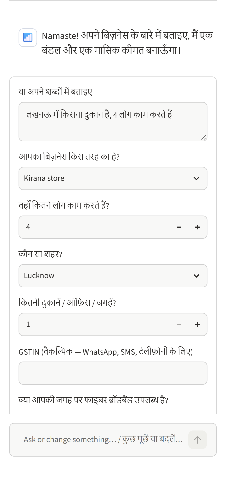
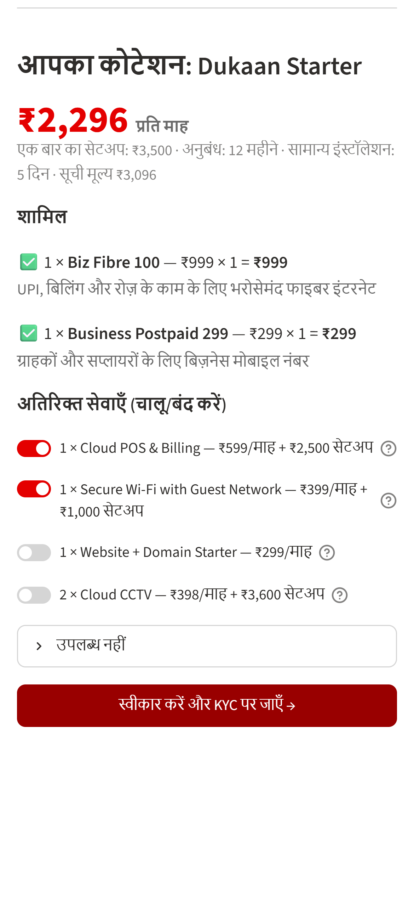
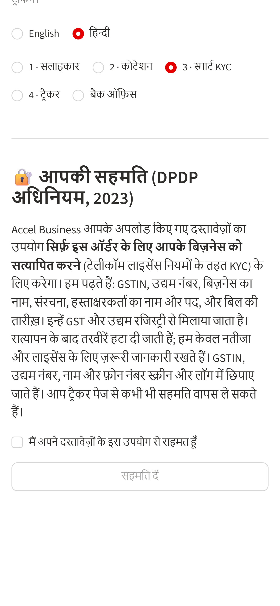
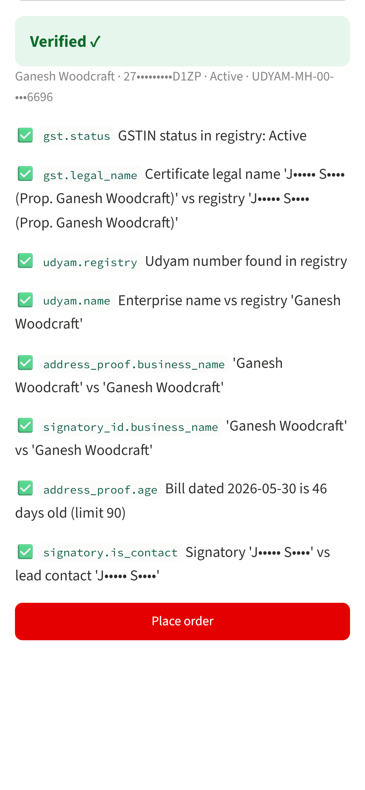
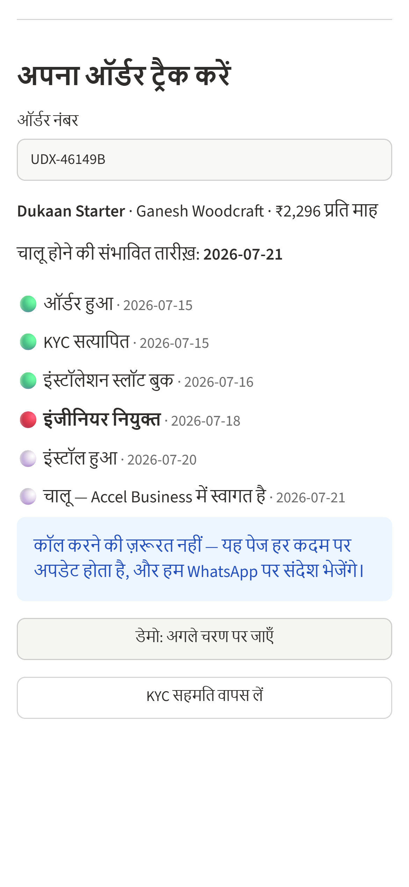

# Udyam Express: Airtel SYNC 2026, Digital Track A

Udyam Express is a digital-first acquisition and onboarding journey for small businesses, built for the fictional operator **Accel Telecom / Accel Business**. A shop owner can find the right bundle, see one monthly price, finish KYC and track installation from their phone, in Hindi or English, without a sales visit.

Built for Airtel SYNC 2026, where Airtel hosts the competition. All data is synthetic.

## The journey
| Step | What it does |
|---|---|
| **1 · Advisor** | The owner describes the business in free text (EN/HI) or a short form. A **rules engine** picks an eligible bundle from the catalogue. An LLM only *explains* that bundle, and a grounding guard rejects any reply that mentions a number or product not in the bundle. |
| **2 · Quote** | One monthly price with add-ons the owner can switch on and off. The server re-prices from `data/product_catalogue.csv` and ignores any prices the client sends. |
| **3 · Smart KYC** | DPDP consent comes first. Then Tesseract OCR with watermark removal, deskew and blur detection, followed by checksum- and registry-guided GSTIN correction, a Udyam lookup, name matching, the 90-day address-proof rule and signatory checks. |
| **4 · Tracker** | Planned dates for every stage, so the owner has no status calls to make. KYC holds and rejects go to a back-office queue. |

## Results
- **Advisor test scenarios: 15 / 15 pass** (`app/tests/advisor_scenarios.yaml`)
- **Smart KYC: 12 / 12 match the answer key** (4 pass, 2 auto-fix, 2 re-capture, 4 reject/hold)
- Full suite: 503 tests pass. The 15 tests that need a live LLM API key are skipped when no key is set.

<p align="center">
  
  
  
  
  
</p>

## Repository layout
| Path | Contents |
|---|---|
| `app/` | The prototype: FastAPI backend (`backend/`), Streamlit front end (`frontend/`), tests and helper scripts. Run instructions are in [app/README.md](app/README.md). |
| `data/` | Case data: SMB leads, mock GSTIN and Udyam registries, and the product catalogue |
| `kyc_documents/` | The 12 synthetic KYC applicants (K01–K12) |
| `analysis/` | Scripts that produced every number in the business case |
| `model/Udyam_Digital_Model.xlsx` | Formula model for the business case, including the KYC answer key |
| `docs/blueprint_v1.md` | Fact base and 7-slide storyline |
| `deck/screenshots/` | Phone screenshots of the prototype plus `SLIDE_VALUES.md` |

## Quick start
```bash
python -m venv .venv
.venv/Scripts/pip install -r app/requirements.txt   # also needs Tesseract OCR 5.x
.venv/Scripts/python -m uvicorn backend.api:app --port 8000 --app-dir app
.venv/Scripts/python -m streamlit run app/frontend/app.py
```
To have an LLM write the advisor explanations, set `ADVISOR_MODEL` and `ANTHROPIC_API_KEY`. Without a key, the advisor uses a bilingual template.
